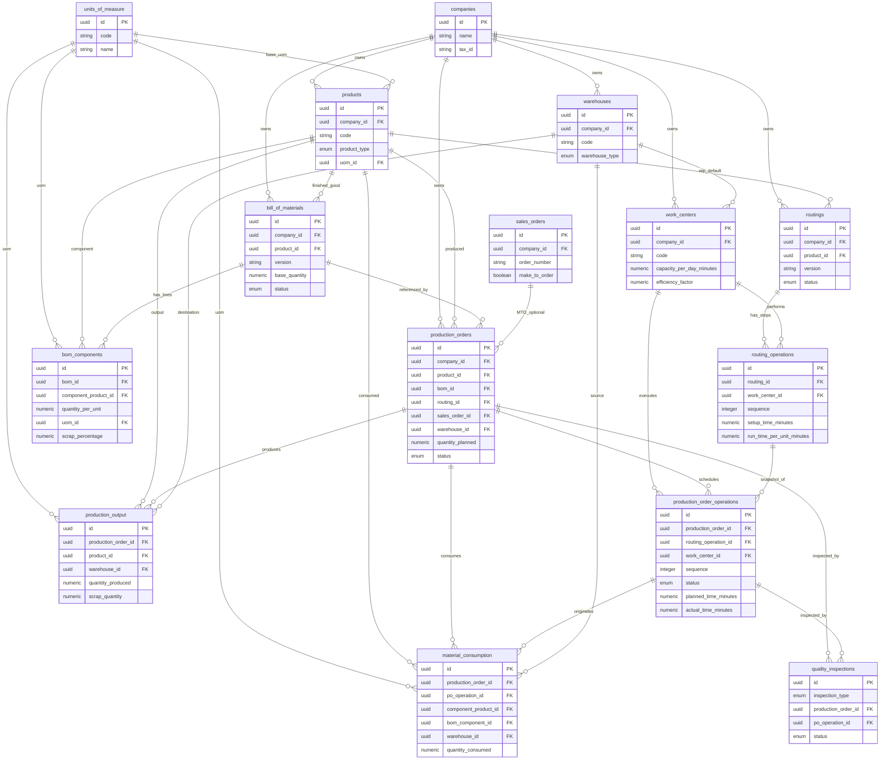

# Modelo de Datos: Módulo de Operaciones / Manufactura (ERP)

**Rama**: `002-operations-manufacturing` | **Fecha**: 2026-10-21
**Fuente base**: `erp_data_model.md` — Módulo 7: Operaciones / Manufactura e integraciones cruzadas.
**Documento relacionado**: [plan.md](plan.md)

> **Nota de reconciliación (trazabilidad).** El archivo fundacional `erp_data_model.md` no está presente en el repositorio al momento de esta redacción. Este documento adopta el esquema canónico de manufactura descrito en la especificación de la funcionalidad (nomenclatura `snake_case`, prefijos de clave `_id`) como **línea base verificable**. Durante la **Fase 1 (Contratos de Datos)** del [plan.md](plan.md) se debe contrastar cada tabla y columna con el `erp_data_model.md` final; cualquier divergencia (nombre, tipo o nulabilidad) se registra como incidencia de arquitectura antes de congelar los contratos de UI.

---

## 1. Alcance del Módulo

El Módulo de Operaciones / Manufactura modela el ciclo **planificado → ejecutado** de la producción: qué se debe fabricar (`bill_of_materials`, `routings`), cómo y dónde se fabrica (`work_centers`, `routing_operations`), qué se ordena (planned) y qué se ejecuta (actual) en la planta (`production_orders`, `production_order_operations`, `material_consumption`, `production_output`).

**Tablas de frontera (integración cruzada, no propias del módulo):**

| Módulo de origen | Tablas de frontera | Rol en manufactura |
|---|---|---|
| Logística / Inventario | `products`, `warehouses` | Bien terminado, componentes y puntos de descuento/ingreso de stock |
| Ventas | `sales_orders` | Disparador de fabricación make-to-order (MTO) |
| Control de Calidad | `quality_inspections` | Ganchos de inspección en proceso y final |
| Núcleo | `companies`, `units_of_measure` | Multi-empresa y unidades de medida |

---

## 2. Clasificación Funcional (Planificado vs. Ejecutado)

| Naturaleza | Tablas | Descripción |
|---|---|---|
| **Maestros de planificación** | `bill_of_materials`, `bom_components`, `work_centers`, `routings`, `routing_operations` | Qué, con qué y dónde *debería* producirse. Definen el estándar/target. |
| **Ejecución transaccional** | `production_orders`, `production_order_operations`, `material_consumption`, `production_output` | Qué se *ordenó* y qué *ocurrió realmente* en el piso de planta. |

**Pináculo de integración planificado ↔ ejecutado:**

- `bom_components.quantity_per_unit` (consumo teórico por unidad) **vs.** `material_consumption.quantity_consumed` (consumo real por lote).
- `routing_operations.setup_time_minutes` + `run_time_per_unit_minutes` (tiempo estándar) **vs.** `production_order_operations.actual_time_minutes` (tiempo real reportado).

---

## 3. Diccionario de Datos

Convenciones: toda PK es `id` de tipo `uuid`; todos los códigos de negocio (`code`) son `string` únicos por empresa salvo indicación contraria. Los campos `created_at` / `updated_at` son `timestamp` obligatorios y se omiten de la prosa para no repetir. **Nullable** indica si la columna admite `NULL`.

### 3.1 `companies` — Núcleo (frontera)

Rol funcional: raíz de aislamiento multi-empresa (multi-tenant). Toda entidad operativa cuelga de una `company_id`.

| Columna | Tipo | PK/FK | Nullable | Restricciones |
|---|---|---|---|---|
| id | uuid | PK | No | — |
| name | string | — | No | no vacío |
| tax_id | string | — | Sí | único por empresa cuando existe |
| default_currency | string | — | Sí | código ISO 4217 |

### 3.2 `units_of_measure` — Núcleo (frontera)

Rol funcional: normaliza magnitudes físicas (kg, L, unidad, m) usadas en BOM, consumo y salida.

| Columna | Tipo | PK/FK | Nullable | Restricciones |
|---|---|---|---|---|
| id | uuid | PK | No | — |
| code | string | — | No | único (p. ej., `KG`, `UN`) |
| name | string | — | No | no vacío |
| category | string | — | Sí | agrupación (masa, volumen, conteo) |
| company_id | uuid | FK → companies.id | Sí | `NULL` = unidad global del sistema |

### 3.3 `products` — Logística (frontera)

Rol funcional: catálogo maestro de artículos. Distingue con `product_type` el **bien terminado** (se fabrica) del **componente** (se consume).

| Columna | Tipo | PK/FK | Nullable | Restricciones |
|---|---|---|---|---|
| id | uuid | PK | No | — |
| company_id | uuid | FK → companies.id | No | — |
| code | string | — | No | único por empresa |
| name | string | — | No | no vacío |
| product_type | enum | — | No | `finished_good` \| `component` \| `raw_material` |
| uom_id | uuid | FK → units_of_measure.id | No | unidad base de inventario |
| unit_cost | numeric(14,4) | — | Sí | ≥ 0; costo estándar usado en valorización de consumo |

### 3.4 `warehouses` — Logística (frontera)

Rol funcional: puntos físicos de stock. Las bodegas de tipo `production` / WIP son el destino del consumo y la fuente de la salida.

| Columna | Tipo | PK/FK | Nullable | Restricciones |
|---|---|---|---|---|
| id | uuid | PK | No | — |
| company_id | uuid | FK → companies.id | No | — |
| code | string | — | No | único por empresa |
| name | string | — | No | no vacío |
| warehouse_type | enum | — | No | `raw_materials` \| `wip` \| `finished_goods` |

### 3.5 `sales_orders` — Ventas (frontera)

Rol funcional: pedido de venta que dispara fabricación make-to-order (MTO) cuando `make_to_order = true`.

| Columna | Tipo | PK/FK | Nullable | Restricciones |
|---|---|---|---|---|
| id | uuid | PK | No | — |
| company_id | uuid | FK → companies.id | No | — |
| customer_id | uuid | FK → companies.id | Sí | contraparte comercial si se usa esa tabla |
| order_number | string | — | No | único por empresa |
| status | enum | — | No | ciclo de ventas (`open`, `confirmed`, …) |
| make_to_order | boolean | — | No | `default false`; habilita vinculación con producción |
| requested_date | date | — | Sí | fecha requerida por el cliente |

### 3.6 `bill_of_materials` — Manufactura (planificado)

Rol funcional: **cabecera/receta** para fabricar 1 unidad del bien terminado. Define la versión vigente de la estructura.

| Columna | Tipo | PK/FK | Nullable | Restricciones |
|---|---|---|---|---|
| id | uuid | PK | No | — |
| company_id | uuid | FK → companies.id | No | — |
| product_id | uuid | FK → products.id | No | **bien terminado** (`product_type = finished_good`) |
| code | string | — | No | único por empresa |
| version | string | — | No | único por (`product_id`, `version`) |
| effective_from | date | — | No | — |
| effective_to | date | — | Sí | ≥ `effective_from` cuando existe |
| base_quantity | numeric(14,4) | — | No | > 0; rendimiento base (p. ej., 1 unidad o 100 kg) |
| status | enum | — | No | `draft` \| `active` \| `obsolete` |
| notes | string | — | Sí | — |

### 3.7 `bom_components` — Manufactura (planificado)

Rol funcional: **líneas de material** de una BOM. Es la fuente del **consumo teórico**.

| Columna | Tipo | PK/FK | Nullable | Restricciones |
|---|---|---|---|---|
| id | uuid | PK | No | — |
| bom_id | uuid | FK → bill_of_materials.id | No | borrado en cascada con la BOM |
| component_product_id | uuid | FK → products.id | No | **materia prima** (`product_type ∈ {component, raw_material}`) |
| quantity_per_unit | numeric(14,6) | — | No | > 0; consumo teórico por `base_quantity` |
| uom_id | uuid | FK → units_of_measure.id | No | unidad del componente |
| scrap_percentage | numeric(6,3) | — | No | ≥ 0; `default 0`; merma prevista |
| sequence | integer | — | No | ≥ 0; orden de presentación/consumo |
| is_optional | boolean | — | No | `default false`; componentes alternos |

**Restricción clave:** `UNIQUE (bom_id, component_product_id)` para evitar líneas duplicadas.

### 3.8 `work_centers` — Manufactura (planificado, capacidad)

Rol funcional: recurso de capacidad donde se ejecutan las operaciones. Es el eje del cálculo de carga/backlog.

| Columna | Tipo | PK/FK | Nullable | Restricciones |
|---|---|---|---|---|
| id | uuid | PK | No | — |
| company_id | uuid | FK → companies.id | No | — |
| code | string | — | No | único por empresa |
| name | string | — | No | no vacío |
| warehouse_id | uuid | FK → warehouses.id | Sí | bodega WIP por defecto |
| capacity_per_day_minutes | numeric(10,2) | — | No | > 0; capacidad nominal diaria |
| efficiency_factor | numeric(5,4) | — | No | `default 1.0`; rango `(0, 1]` |
| cost_per_hour | numeric(14,4) | — | Sí | ≥ 0 |
| status | enum | — | No | `active` \| `inactive` |

### 3.9 `routings` — Manufactura (planificado, secuencia)

Rol funcional: **cabecera de ruta** de fabricación para un producto; agrupa las operaciones en secuencia.

| Columna | Tipo | PK/FK | Nullable | Restricciones |
|---|---|---|---|---|
| id | uuid | PK | No | — |
| company_id | uuid | FK → companies.id | No | — |
| product_id | uuid | FK → products.id | No | bien terminado a fabricar |
| code | string | — | No | único por empresa |
| version | string | — | No | único por (`product_id`, `version`) |
| status | enum | — | No | `draft` \| `active` \| `obsolete` |

### 3.10 `routing_operations` — Manufactura (planificado, secuencia)

Rol funcional: **pasos ordenados** de una ruta y sus tiempos estándar. Define la secuencia obligatoria de ejecución.

| Columna | Tipo | PK/FK | Nullable | Restricciones |
|---|---|---|---|---|
| id | uuid | PK | No | — |
| routing_id | uuid | FK → routings.id | No | borrado en cascada con la ruta |
| work_center_id | uuid | FK → work_centers.id | No | recurso donde se ejecuta |
| sequence | integer | — | No | ≥ 10, estrictamente creciente dentro de la ruta |
| description | string | — | Sí | — |
| setup_time_minutes | numeric(10,2) | — | No | ≥ 0; tiempo de alistamiento por lote |
| run_time_per_unit_minutes | numeric(10,4) | — | No | ≥ 0; tiempo de proceso por unidad |

### 3.11 `production_orders` — Manufactura (ejecución)

Rol funcional: **orden de fabricación** de un lote. Es el núcleo operativo y el objeto de la máquina de estados `planned → released → in_progress → completed → cancelled`.

| Columna | Tipo | PK/FK | Nullable | Restricciones |
|---|---|---|---|---|
| id | uuid | PK | No | — |
| company_id | uuid | FK → companies.id | No | — |
| order_number | string | — | No | único por empresa |
| product_id | uuid | FK → products.id | No | bien terminado a producir |
| bom_id | uuid | FK → bill_of_materials.id | No | receta congelada al liberar |
| routing_id | uuid | FK → routings.id | Sí | requerido para generar operaciones |
| **sales_order_id** | uuid | FK → sales_orders.id | **Sí** | **enlace make-to-order opcional** (`NULL` = fabricación a stock) |
| warehouse_id | uuid | FK → warehouses.id | No | bodega destino del bien terminado |
| quantity_planned | numeric(14,4) | — | No | > 0 (variable de trazabilidad) |
| status | enum | — | No | `planned` \| `released` \| `in_progress` \| `completed` \| `cancelled` |
| planned_start_date | date | — | Sí | — |
| planned_end_date | date | — | Sí | ≥ `planned_start_date` |
| actual_start_date | date | — | Sí | se fija al pasar a `in_progress` |
| actual_end_date | date | — | Sí | se fija al pasar a `completed` |
| priority | enum | — | No | `low` \| `normal` \| `high`; `default normal` |
| notes | string | — | Sí | — |

### 3.12 `production_order_operations` — Manufactura (ejecución)

Rol funcional: **instantánea congelada** de las operaciones de la ruta para una orden concreta; registra estado y tiempo real por paso.

| Columna | Tipo | PK/FK | Nullable | Restricciones |
|---|---|---|---|---|
| id | uuid | PK | No | — |
| production_order_id | uuid | FK → production_orders.id | No | borrado en cascada con la orden |
| routing_operation_id | uuid | FK → routing_operations.id | Sí | origen teórico (puede quedar `NULL` si la ruta cambia después) |
| work_center_id | uuid | FK → work_centers.id | No | copia desnormalizada para reportes |
| sequence | integer | — | No | ≥ 10; orden de ejecución |
| status | enum | — | No | `pending` \| `in_progress` \| `paused` \| `completed` |
| planned_time_minutes | numeric(10,2) | — | No | ≥ 0; estándar congelado |
| actual_time_minutes | numeric(12,2) | — | Sí | ≥ 0; **variable de trazabilidad** de desempeño real |
| quantity_completed | numeric(14,4) | — | No | `default 0`; ≥ 0 |
| scrap_quantity | numeric(14,4) | — | No | `default 0`; ≥ 0 |
| operator_id | uuid | FK → (usuarios/operadores) | Sí | **sensible**: métricas por persona; ver §6 |
| started_at | timestamp | — | Sí | — |
| completed_at | timestamp | — | Sí | ≥ `started_at` cuando existe |

### 3.13 `material_consumption` — Manufactura (ejecución)

Rol funcional: **registro real de consumo** en el piso de planta. Conecta el componente teórico del BOM con el movimiento de inventario real.

| Columna | Tipo | PK/FK | Nullable | Restricciones |
|---|---|---|---|---|
| id | uuid | PK | No | — |
| production_order_id | uuid | FK → production_orders.id | No | — |
| po_operation_id | uuid | FK → production_order_operations.id | Sí | operación que origina el consumo |
| component_product_id | uuid | FK → products.id | No | materia prima consumida |
| bom_component_id | uuid | FK → bom_components.id | Sí | línea teórica de referencia (puede ser consumo no planeado) |
| warehouse_id | uuid | FK → warehouses.id | No | bodega fuente (descuento de stock) |
| quantity_consumed | numeric(14,6) | — | No | > 0; **variable de trazabilidad** de consumo real |
| uom_id | uuid | FK → units_of_measure.id | No | — |
| lot_number | string | — | Sí | trazabilidad de lote |
| consumed_at | timestamp | — | No | — |
| consumed_by | uuid | FK → (usuarios/operadores) | Sí | **sensible**: quién registró; ver §6 |

### 3.14 `production_output` — Manufactura (ejecución)

Rol funcional: **registro real de bien terminado** producido (ingreso a bodega), incluyendo merma.

| Columna | Tipo | PK/FK | Nullable | Restricciones |
|---|---|---|---|---|
| id | uuid | PK | No | — |
| production_order_id | uuid | FK → production_orders.id | No | — |
| product_id | uuid | FK → products.id | No | bien terminado producido |
| warehouse_id | uuid | FK → warehouses.id | No | bodega destino (ingreso de stock) |
| quantity_produced | numeric(14,4) | — | No | > 0; **variable de trazabilidad** de salida real |
| scrap_quantity | numeric(14,4) | — | No | `default 0`; ≥ 0 |
| lot_number | string | — | Sí | trazabilidad de lote terminado |
| uom_id | uuid | FK → units_of_measure.id | No | — |
| produced_at | timestamp | — | No | — |
| recorded_by | uuid | FK → (usuarios/operadores) | Sí | **sensible**: quién reportó; ver §6 |

### 3.15 `quality_inspections` — Control de Calidad (frontera, gancho)

Rol funcional: inspección asociada (en proceso o final) desde el módulo de calidad. Manufactura solo la **referencia**; no la posee.

| Columna | Tipo | PK/FK | Nullable | Restricciones |
|---|---|---|---|---|
| id | uuid | PK | No | — |
| company_id | uuid | FK → companies.id | No | — |
| inspection_type | enum | — | No | `in_process` \| `final` |
| production_order_id | uuid | FK → production_orders.id | Sí | gancho hacia la orden |
| po_operation_id | uuid | FK → production_order_operations.id | Sí | inspección en proceso por paso |
| product_id | uuid | FK → products.id | Sí | inspección final sobre el bien terminado |
| status | enum | — | No | `pending` \| `passed` \| `failed` |

> **Decisión de frontera:** la orden de producción **no** almacena un `quality_status` propio; el estado de calidad se **deriva** consultando `quality_inspections`. Esto evita acoplar el ciclo de manufactura al ciclo de calidad y mantiene la integración como hook de solo lectura hasta la Fase 4.

---

## 4. Relaciones y Cardinalidades

| Relación | Cardinalidad | Semántica |
|---|---|---|
| companies → (todas) | 1:N | aislamiento multi-empresa |
| products → bill_of_materials (`product_id`) | 1:N | un bien terminado tiene varias versiones de BOM |
| bill_of_materials → bom_components | 1:N | cabecera → líneas de material |
| products → bom_components (`component_product_id`) | 1:N | un componente aparece en muchas BOM |
| **`bill_of_materials` ⟷ `products` (vía `bom_components`)** | **N:M** | **una BOM usa muchos componentes; un componente es usado por muchas BOM** |
| routings → routing_operations | 1:N | cabecera → pasos secuenciales |
| work_centers → routing_operations | 1:N | un centro ejecuta muchas operaciones teóricas |
| work_centers → production_order_operations | 1:N | un centro ejecuta muchas operaciones reales (carga) |
| products → production_orders (`product_id`) | 1:N | un bien terminado se fabrica en muchas órdenes |
| bill_of_materials → production_orders (`bom_id`) | 1:N | versión de BOM usada por varias órdenes |
| routings → production_orders (`routing_id`) | 1:N (nullable) | ruta usada; puede no especificarse |
| sales_orders → production_orders (`sales_order_id`) | 1:N (nullable) | **MTO opcional**; `NULL` = fabricación a stock |
| production_orders → production_order_operations | 1:N | orden → operaciones congeladas |
| production_order_operations → material_consumption | 1:N (nullable) | consumo originado por paso |
| production_orders → material_consumption | 1:N | consumo real de la orden |
| bill_of_materials → material_consumption (vía `bom_components`) | 1:N | comparación plan vs. real |
| production_orders → production_output | 1:N | salida real (posibles salidas parciales) |
| production_orders → quality_inspections | 1:N (nullable) | ganchos de inspección |
| production_order_operations → quality_inspections | 1:N (nullable) | inspección en proceso |

`companies`, `units_of_measure` y `warehouses` aparecen como destinos FK (`1:N` cada uno) desde las tablas operativas que los referencian.

---

## 5. Diagrama ERD (Mermaid)

---

## 6. Variables y Tablas Críticas

### 6.1 Impulsores operativos centrales

| Tabla/Variable | Justificación |
|---|---|
| `production_orders` | Entidad pivote: sin ella no hay ejecución, trazabilidad ni vínculo MTO/comercial. Determina el estado global del negocio de fabricación. |
| `bill_of_materials` + `bom_components` | Definen el consumo teórico y la estructura de costos; cualquier error se propaga a inventario y márgenes. |
| `material_consumption` | Registro real de consumo: nexo entre ejecución y descuento de inventario; base del análisis plan vs. real. |

### 6.2 Restricciones de capacidad y secuencia

| Tabla/Variable | Justificación |
|---|---|
| `work_centers.capacity_per_day_minutes` | Fija el techo de capacidad; base del cálculo de carga y detección de cuellos de botella. |
| `routing_operations.sequence`, `setup_time_minutes`, `run_time_per_unit_minutes` | Definen el orden obligatorio y el tiempo estándar; habilitan el cálculo de `planned_time_minutes` y la detección de violaciones de secuencia. |

### 6.3 Variables de trazabilidad aguas abajo

| Variable | Tabla | Significado en el negocio |
|---|---|---|
| `quantity_planned` | `production_orders` | Meta de producción del lote. |
| `quantity_consumed` | `material_consumption` | Consumo real; comparado con `bom_components.quantity_per_unit` revela mermas/ineficiencias. |
| `quantity_produced` | `production_output` | Salida real; confrontada con `quantity_planned` arroja cumplimiento y rendimiento. |
| `actual_time_minutes` | `production_order_operations` | Tiempo real; contra `planned_time_minutes` mide eficiencia y desviación de estándar. |

**Indicadores derivados (no persistidos, calculados en UI):** *Yield* = `SUM(quantity_produced) / quantity_planned`; *Scrap rate* = `scrap_quantity / (quantity_produced + scrap_quantity)`; *Consumption variance* = (`quantity_consumed` − `quantity_planned × quantity_per_unit`) / teórico.

---

## 7. Ética de Datos, Privacidad y Gestión de Sesgos

### 7.1 Sesgo en el seguimiento del desempeño laboral

`production_order_operations.operator_id` / `actual_time_minutes` y `material_consumption.consumed_by` / `production_output.recorded_by` permiten construir métricas de productividad individual. Riesgos y controles:

- **Riesgo de sesgo:** comparar operadores por tiempo real sin normalizar por tipo de máquina, complejidad del producto, turno o antigüedad penaliza injustamente a quien recibe trabajo más difícil.
- **Control de diseño:** las vistas de análisis de MVP agregan por **centro de trabajo / operación**, no por persona. Cualquier vista individual requiere aprobación explícita y se etiqueta como "solo contexto operacional, no evaluación de desempeño".
- **Minimización:** `operator_id` es nullable y se captura solo cuando el proceso de negocio lo exige; el prototipo de MVP no expone rankings de operadores.
- **Transparencia:** los usuarios deben saber que los tiempos se registran; el reporte de tiempo se presenta como dato de proceso, no como vigilancia.

### 7.2 Integridad de reportes de merma, seguridad e inventario

- **Merma (`scrap_quantity`)**: debe capturarse a nivel de operación **y** de salida, con motivo obligatorio cuando `scrap_quantity > 0`, para evitar que la merma "desaparezca" y distorsione costos y rendimiento.
- **Seguridad**: los eventos de merma/incidente deben quedar inmutables (append-only) y con marca de autor (`consumed_by` / `recorded_by`) para auditoría; nunca borrar un registro de consumo o salida.
- **Discrepancias de inventario**: la conciliación `bom_components` (teórico) vs. `material_consumption` (real) vs. movimiento de `warehouses` debe ser visible y trazable; se prohíbe ajustar cantidades silenciosamente. Toda corrección se modela como un nuevo registro con justificación, preservando la historia.
- **Sesgo de reporte**: si los operadores perciben que reportar merma los penaliza, subreportarán. La política de UX debe desacoplar el reporte de merma del desempeño individual (ver §7.1).

---

## 8. Reglas de Validación Consolidadas

- `bom_components.bom_id` + `component_product_id`: único; `quantity_per_unit > 0`.
- `bill_of_materials.product_id`: debe ser `finished_good`; `base_quantity > 0`.
- `routing_operations.sequence`: entero ≥ 10, estrictamente creciente dentro de `routing_id`.
- `production_orders`: transiciones de `status` restringidas a `planned → released → in_progress → completed`; `cancelled` alcanzable desde cualquier estado no terminal; el salto inverso no se permite sin evento explícito.
- `production_orders.quantity_planned > 0`; `actual_end_date >= actual_start_date`.
- `material_consumption.quantity_consumed > 0`; `production_output.quantity_produced > 0`.
- Toda FK nullable (`sales_order_id`, `routing_id`, `po_operation_id`, `bom_component_id`) debe ser explícitamente `NULL` cuando el vínculo no existe; **no** usar valores centinela.
- Borrado en cascada: `bill_of_materials → bom_components`, `routings → routing_operations`, `production_orders → production_order_operations`.
- Borrado restringido: no eliminar `products` / `warehouses` con documentos operativos dependientes.
